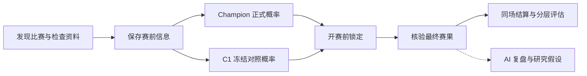

# VCT Forecast Lab

**可追溯的 VALORANT 赛事预测与模型评估系统**

从一场比赛的赛前判断，到一套模型的长期检验：保存当时可用的信息、锁定预测概率、核验真实赛果，再用同场对照判断模型是否值得改进。

An end-to-end forecasting system with point-in-time features, immutable pre-match predictions, prospective model evaluation, and evidence-linked AI analysis.

[在线体验](https://vct-forecast-lab.limuchuan128.chatgpt.site/) · [预测历史](https://vct-forecast-lab.limuchuan128.chatgpt.site/predictions) · [评估方法](docs/evaluation.md) · [系统设计](docs/architecture.md) · [验证记录](docs/verification.md)

## 项目概览

| 产品 | 数据 | 模型 | 工程 |
|---|---|---|---|
| 赛前预测、历史记录、赛后复盘、模型实验室 | 比赛 → 地图 → 选手，保留来源与时间 | Champion 正式预测 + 冻结 Logistic C1 对照 | 有预算的云端采集、赛果确认、可追溯结算、独立 AI 任务 |

**截至 2026-11-09 14:43（北京时间）的公开聚合快照：97 场正式预测 · 80 场有效模型配对 · 主赛评估 34/100。** 80 场包含多个独立赛事级别，不等于主赛门槛已完成 80 场。网站为 LIVE，最近一次同步成功；赛事覆盖与 AI 内容仍有明确限制。

本次代码导出对应 **Sites Version 44** 与 Runner 11 月 4 日已上线的赛果修复、分层评估能力。[数据快照](docs/data/evaluation-snapshot-2026-11-09.json)与[源码对应表](docs/source-snapshot.json)分别记录指标和代码出处。

## 模型表现：让结果可以被检查


| 评价场景 | 样本 | Elo | Champion | Logistic C1 |
|---|---:|---:|---:|---:|
| 固定历史 Test | 200 场 | 56.0% · 112/200 | 61.0% · 122/200¹ | 59.0% · 118/200 |
| 真实赛前锁定的主赛对照 | 34 场 | 无对应的真实冻结记录 | 55.9% · 19/34 | 64.7% · 22/34 |

¹ 历史 Champion 为**可安全回放因素构成的部分代理**，不能视为完整线上模型的精确重建。历史结果来自已保存的单次测试记录，本次没有重新运行 Test 或调参。DeepSeek 提供解释与诊断，没有独立的正式概率记录，因此不编造其准确率。

真实主赛对照中，C1 的 Brier 为 **0.2356**，Champion 为 **0.2479**；但 C1 的校准误差更高。**当前结论仍为初步观察，C1 未晋级。** 命中率之外，还要检验模型给出的把握是否合理、优势是否能在更多新比赛中保持。

### 不同赛事级别，分别检验


国内晋升赛为 **21 场**，Champion 命中 **9 场**，C1 命中 **14 场**；EMEA 次级赛 **16 场**，双方均命中 **11 场**。美洲资格赛等小样本的较差结果也完整保留。不同地区与级别没有合并成一个“总准确率”，1–5 场的结果不足以判断模型优劣。

图中横线为描述性 95% Wilson 区间；未处理同队伍、多场比赛之间的相关性，不能用区间重叠与否替代正式的配对比较。

<details>
<summary>展开：Brier、Log Loss 与校准误差</summary>


- **Brier**：给出的胜率距离真实结果有多远。
- **Log Loss**：尤其惩罚“非常自信却判断错误”。
- **校准误差 ECE**：例如长期给出 70% 的判断，是否大约有 70% 成真；这里使用 10 个固定区间。

同一批比赛上，C1 的 Brier、Log Loss 较低，ECE 较高。所有数值与完整分层表见[模型评估](docs/evaluation.md)。

</details>

## 一场比赛如何进入系统



前台聚焦比赛：**首页**集中查看预测、历史和复盘，进入单场再查看依据、地图分析与实际赛果；**模型实验室**展示长期表现。后台持续检查 CN、EMEA、美洲、太平洋及国际赛事，资料不足的比赛进入观察状态，并保留阻塞原因。

## 核心工程决策

| 问题 | 实现选择 | 可以检查的证据 |
|---|---|---|
| 历史回测可能偷看未来 | 所有动态特征只读 `source_time < match_time`；从此前比赛重建状态 | [历史回放](model/src/vct_prediction/replay.py)与未来数据污染测试 |
| 赛后改写预测会让成绩失真 | 同一赛前快照绑定 Champion / C1，锁定概率、版本和输入哈希 | [冻结与独立结算](runner/src/vct_prediction/shadow.py) |
| 进行中的地图面板可能被误当终局 | 地图终局、地图胜者、系列赛比分相互核验，并要求稳定确认 | [赛果完整性](runner/src/vct_prediction/sources/vlr.py) |
| 赛制或来源身份变化会污染评估 | 冲突隔离、版本化记录；从已确认结果恢复结算时不重算实力分 | [结算检查与恢复](runner/src/vct_prediction/settlement_checks.py) |
| 新赛事与资料准备增加云端负担 | 请求、详情和时间预算；缓存与轮转；比赛级别分层 | [自动流程](runner/src/vct_prediction/automation.py)、[资料准备](runner/src/vct_prediction/readiness.py) |
| AI 生成失败可能拖垮主流程 | 赛前、赛后任务独立，有限重试；事实、模型信号、推测分别保存 | [AI 任务](site/lib/ai-reliability.ts)、[证据约束](site/lib/review-evidence.ts) |

一个已处理的真实边界：赛前保存为 BO3 的比赛，后来收到 BO5 的 2–3 赛果。系统保留原预测并隔离这组冲突，阻止它混入正式成绩。[分层评价模块](runner/src/vct_prediction/cohort_evaluation.py)还会核验冻结时点、输入与 artifact 身份，并复现保存的 C1 概率。

## 代码结构与技术栈

三个生产项目保持独立；本仓库是经过筛选、保留公开复现能力的作品集代码快照。

| 目录 | 主要职责 | 入口 |
|---|---|---|
| [model/](model/) | Python 预测、严格历史回放、Logistic 离线评估 | [replay.py](model/src/vct_prediction/replay.py)、[challenger.py](model/src/vct_prediction/challenger.py) |
| [runner/](runner/) | 云端赛程发现、质量检查、赛前锁定、赛果确认、分层评价 | [automation.py](runner/src/vct_prediction/automation.py)、[cohort_evaluation.py](runner/src/vct_prediction/cohort_evaluation.py) |
| [site/](site/) | 比赛界面、D1 记录、DeepSeek 解释与复盘 | [prediction-store.ts](site/lib/prediction-store.ts)、[deepseek.ts](site/lib/deepseek.ts) |
| [docs/](docs/) | 架构、数据方法、评估协议、验证证据与图表 | [Architecture](docs/architecture.md)、[Evaluation](docs/evaluation.md) |
| [scripts/](scripts/) | 从已保存聚合指标重绘展示图表 | [render_evaluation_charts.py](scripts/render_evaluation_charts.py) |

**Python · SQLite · React · TypeScript · Vinext / Vite · Cloudflare D1 · Railway · DeepSeek**

项目以 AI 辅助开发推进。这里展示的是已经实现、部署或验证的产品与工程能力，不宣称未经验证的用户规模、商业成效或自动进化成果。

## 检查与复现

公开仓库提供隔离测试和合成示例，不附生产数据库。依赖私有历史数据的检查会明确跳过。

```powershell
# runner/：在安装 requirements.txt 所列依赖的 Python 环境中
$env:PYTHONPATH = "src;tests"
python -m unittest discover -s tests

# site/：Node.js 22.13+，按现有 lockfile 准备依赖
npm ci
npm test
npm run build

# 仓库根目录：图表仅需 Pillow 与本机 TrueType 字体
python scripts/render_evaluation_charts.py
```

本次增量检查：**Runner 60 passed / 8 skipped；Site 54 passed，TypeScript 与生产构建通过**。图表由已保存的聚合 JSON 生成，提供 PNG 与 SVG；重绘图表不会采集数据、训练模型或重新使用历史 Test。具体命令与范围见[验证记录](docs/verification.md)。

## 研究边界与后续工作

- **覆盖**：来源索引成功不等于所有真实赛事均已收录；新队伍历史不足、赛制不支持与详情预算仍会阻塞预测。
- **数据**：VLR 为社区二手来源；真实 Patch、官方赛前阵容时间线、完整回合与经济数据不齐全。`event_cohort` 只是赛事分组代理。
- **AI**：赛前解释与赛后复盘仍存在结构校验失败和内容质量问题。AI 没有修改正式概率、训练模型或决定晋级的权限。
- **模型**：Champion 继续提供唯一正式概率；C1 参数冻结。下一步是积累新样本、分别研究地区和级别差异，使用独立验证协议评估改进。

仓库排除密钥、真实环境变量、数据库、原始页面、逐场训练数据、生产日志和部署绑定。C1 公共参数子集与完整生产 artifact 使用不同哈希，不能相互冒充。代码公开不代表第三方赛事数据获得再分发授权。

独立作品集与研究项目，与 Riot Games、VALORANT Champions Tour、VLR.gg 无隶属关系。尚未选择开源许可证。
