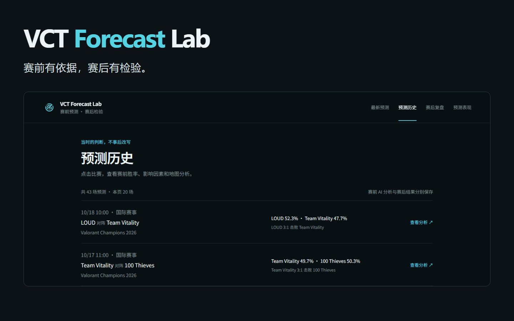
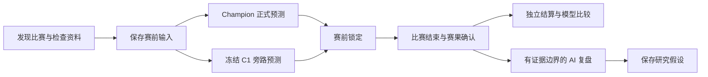

# VCT Forecast Lab

**一个把赛前判断保存下来、用真实赛果检验模型的无畏契约赛事预测产品。**

An explainable VALORANT forecasting product with frozen pre-match predictions, real-result evaluation, and evidence-bounded AI reviews.

[体验网站](https://vct-forecast-lab.limuchuan128.chatgpt.site/) · [系统设计](docs/architecture.md) · [模型评估](docs/evaluation.md) · [代码入口](#系统结构与代码入口)



## 这个项目解决什么问题？

比赛结束后，总能找到听起来合理的解释。更难的问题是：**赛前到底知道什么、给出了什么概率，以及长期来看这些概率是否可信？**

VCT Forecast Lab 把这个过程做成了可运行的网站：

- **看预测**：展示系统已生成的比赛预测，点进比赛再看判断依据、地图胜率与比分分布。
- **留记录**：赛前保存输入和概率，开赛后不回头改写判断。
- **看复盘**：确认赛果后呈现地图、选手表现和 AI 分析，区分事实与推测。
- **比模型**：正式模型与冻结的候选模型并行预测，以同一批真实比赛比较概率质量。

这不是“已经证明能够自动进化”的系统。它是一个**已经部署、正在积累真实检验样本的预测与评估产品**。

## 当前进展

以下为 **2026-10-19 19:18（北京时间）**从生产聚合接口读取的快照，不是实时承诺：

| 项目 | 已验证状态 |
|---|---|
| 网站正式预测历史 | 43 场 |
| Champion / C1 合格已结算配对 | 34 场，进入初步观察阶段 |
| C1 正式评估门槛 | 100 场，达到门槛也不自动晋级 |
| 合格的前瞻学习比赛 | 42 场，与 C1 配对口径不同 |
| 正式预测模型 | Champion V1.0.0，权重不变 |
| 候选模型 | Logistic C1，参数冻结、仅作旁路比较 |
| 评估数据一致性 | 34 组合格配对通过一致性检查 |
| 赛事覆盖 | 四赛区来源索引已接入，覆盖仍不完整 |

网站与数据同步正常工作，不等于每场比赛都有足够资料可以预测，也不等于所有 AI 复盘请求都成功。当前 AI 超时、结构校验失败和新队伍历史不足仍是明确的待改进项。

## 从预测到检验



**AI 负责解释与提出假设，不负责改概率、改参数、训练或批准模型晋级。**

## 工程上值得看的部分

### 不偷看未来的历史回放

历史输入必须满足 `source_time < target_match_time`。不能把队伍今天的最终状态填回过去，也不能把目标比赛的实际阵容、地图和结果当成赛前信息。

已完成小样本回放验证及扩大后的未来数据污染测试。历史测试集与网站真实赛前锁定样本始终分开。

### 不把进行中的比分当作最终赛果

地图终局比分、地图胜者、系列赛比分必须相互一致。候选结果经过稳定性确认后才可结算；冲突通过隔离与版本化修订处理，而不是悄悄覆盖历史。

### 不把更多赛事等同于更好的覆盖

云端会检查 CN、EMEA、美洲、太平洋及国际赛事，支持跨年赛季、资格赛、晋升赛、次级赛事与邀请赛的发现。

但发现比赛之后仍要检查对阵、时间、赛制、地图和历史资料。未知或资料不足的比赛继续观察，不编造概率。不同赛事级别分别记录，不混入原有主要 VCT 的百场评估。

### 不把 AI 的解释包装成事实

赛前分析与赛后复盘有独立任务状态、错误分类和有限重试。复盘使用已保存的预测及已确认的统计，并区分：

- **事实**：比分、地图和可核验的比赛统计。
- **模型信号**：赛前实际使用的变量与输出。
- **研究假设**：尚未被验证的可能原因。

AI 失败不应阻断确定性的赛果结算。缺少完整回合证据时，不声称已经证明了战术因果。

## 模型评估

### 已完成的历史比较

按时间固定拆分为 **650 场训练 / 150 场验证 / 200 场测试**；测试集未用于事后调参。

| 模型 | Brier ↓ | Log Loss ↓ | Accuracy ↑ |
|---|---:|---:|---:|
| Elo 基线 | 0.252311 | 0.703687 | 56.0% |
| Champion 历史部分代理 | 0.243952 | 0.683014 | 61.0% |
| Logistic C1 | 0.243037 | 0.679587 | 59.0% |

**结论：INCONCLUSIVE，C1 未晋级。** Champion 这一行是可安全回放因素构成的部分代理，不是完整线上模型的完美重建。

### 正在积累的真实赛前比较

截至上述读取时间，同一批 **34 场**合格已结算配对：

| 模型 | Brier ↓ | Log Loss ↓ | Accuracy ↑ | ECE ↓ |
|---|---:|---:|---:|---:|
| Champion V1.0.0 | 0.247917 | 0.689298 | 55.9% | 0.039284 |
| Logistic C1 | 0.235605 | 0.664047 | 64.7% | 0.131233 |

**只是早期观察，不是胜出或晋级结论。** C1 在这批样本上的 Brier、Log Loss 较好，但 ECE 更差；小样本不足以证明长期优势。历史 200 场测试绝不计入这里。

完整口径见 [Evaluation](docs/evaluation.md)。

## 系统结构与代码入口

三个生产项目保持独立；这个仓库是面向作品集的、经过筛选的源代码快照，不是生产数据库的镜像。

| 目录 | 职责 | 建议先看 |
|---|---|---|
| [model/](model/) | Python 预测、历史回放、候选模型离线评估 | [replay.py](model/src/vct_prediction/replay.py)、[challenger.py](model/src/vct_prediction/challenger.py) |
| [runner/](runner/) | 云端赛程发现、赛前锁定、赛果确认、旁路评估 | [competition.py](runner/src/vct_prediction/competition.py)、[automation.py](runner/src/vct_prediction/automation.py)、[shadow.py](runner/src/vct_prediction/shadow.py) |
| [site/](site/) | React / TypeScript 页面、D1 记录与 DeepSeek 分析 | [prediction-store.ts](site/lib/prediction-store.ts)、[deepseek.ts](site/lib/deepseek.ts)、[reader-analysis.ts](site/lib/reader-analysis.ts) |

**主要技术**：Python、SQLite、React、TypeScript、Vinext / Vite、Cloudflare D1、Railway、DeepSeek。

架构与方法：[Architecture](docs/architecture.md) / [Data Methodology](docs/data-methodology.md) / [AI Governance](docs/ai-governance.md) / [Model Evolution](docs/model-evolution.md)。

## 本地检查

本仓库不携带生产数据。公开测试使用隔离数据；依赖私有历史数据库的回放测试会跳过。组件运行方式见各目录 README，验证记录见 [Verification](docs/verification.md)。

```powershell
# 在 runner/ 下：安装 requirements.txt 中的依赖后
$env:PYTHONPATH = "src"
python -m unittest discover -s tests

# 在 site/ 下：Node.js 22.13+，按 lockfile 安装依赖后
npm ci
npm test
npm run build
```

示例记录见 [examples/](examples/)，均为合成示例。C1 公开文件只包含复现打分所需的参数和聚合评价，不包含历史比赛数据行；公开子集文件的哈希不冒充完整生产 artifact 哈希。

## 当前边界与下一步

- 四赛区来源索引接通不等于覆盖全网所有比赛；新队伍历史资料的定向补齐仍需完善。
- VLR 是社区二手来源，不是官方 Riot API；访问稳定性、使用条款与数据授权需要单独处理。
- 真实游戏版本、官方赛前阵容时间线、完整回合与经济数据并不齐全。
- 已保存的 `event_cohort` 是赛事分组代理，不是真实游戏 Patch。
- AI 复盘的内容质量、超时与结构校验失败仍需改进。
- C1 继续冻结观察。未来训练、候选模型选择和晋级都需要独立授权与评估，尚未发生。

## 发布与使用说明

此仓库不发布密钥、真实 `.env`、SQLite 数据库、原始采集页面、逐场训练数据、生产日志或云端部署绑定。代码公开不代表第三方赛事数据获得了再分发许可。

这是独立的作品集与研究项目，与 Riot Games、VALORANT Champions Tour、VLR.gg 无隶属关系。尚未选择开源许可证。
