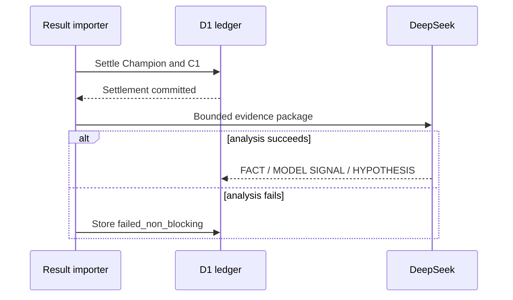

# AI Governance

DeepSeek is an analysis layer, not the forecasting authority.

## Allowed responsibilities

DeepSeek may:

- explain a frozen prediction using supplied evidence;
- compare Champion and Challenger signals;
- diagnose a wrong prediction after a confirmed result;
- identify possible recurring error patterns;
- propose a short research hypothesis.

## Forbidden responsibilities

DeepSeek may not:

- change the official probability;
- replace the mathematical prediction;
- retrain a model;
- modify coefficients;
- modify features;
- modify code;
- create a new challenger automatically;
- promote or reject a challenger;
- override Champion V1.0.0;
- present a hypothesis as a confirmed cause.

The stored permission fields for direct probability change, training and promotion are all false.

## Evidence boundary

Each diagnosis separates three kinds of statements.

### FACT

A claim supported by stored evidence, such as:

- the confirmed match result;
- an observed post-match statistic;
- a prediction freeze time;
- a model version or artifact hash.

### MODEL SIGNAL

Something the models actually consumed or produced, such as:

- Champion probability;
- C1 probability;
- probability gap;
- pre-match feature value;
- missing/imputed status;
- variable contribution.

### HYPOTHESIS

A possible explanation for an error, for example:

> Roster-change uncertainty may be underrepresented.

This is not a fact or a causal conclusion. It is a candidate for a future, separately versioned experiment.

> AI proposes hypotheses; statistical evaluation decides whether they are useful.

## Diagnosis flow

Settlement occurs before the optional AI call. A timeout or provider error cannot erase or block the model result.

## Diagnosis ledger

The first schema stores:

- match and prediction IDs;
- Champion/C1 correctness;
- allowed diagnostic tags;
- hypotheses and evidence references;
- confidence;
- DeepSeek model ID;
- prompt and schema versions;
- completion/failure status;
- direct-model-control flag.

The bounded initial tag set is:

- rating_lag
- recent_form
- roster_change
- map_matchup
- player_form
- cross_region
- missing_context
- calibration
- unexplained

Tags support hypothesis mining, not causal proof. Aggregated analysis returns **INSUFFICIENT_SAMPLE** when too few settled diagnoses exist.

## Promotion governance

DeepSeek output is never part of the automatic promotion decision. A future authorized evaluation may use hypotheses to design a new frozen challenger, but that challenger must have:

1. a new model identity;
2. a new dataset/protocol version;
3. a train-only preprocessing fit;
4. an untouched validation/test plan;
5. prospective evidence;
6. an explicit human-governed decision.

## Current reader-review policy

Sites Version44 uses `vct-postmatch-deepseek-v20-balanced1` / `facts-first-advisory-v1`. Exact source-backed numeric restatement, repetition and cautious interpretation are editorial warnings rather than unconditional rejection. Invalid structure, invented numerical facts, incorrect score evidence and mismatched map/player references remain constrained by the evidence validator. This is bounded validation, not a universal semantic guarantee.

At most one validation repair follows a generation request; queued jobs retain finite retries and their saved prompt/input contracts. Prematch and postmatch states remain independent. Dated public reliability counts are preserved in the portfolio aggregate snapshot; successful sync or build does not mean every AI article succeeds or has professional editorial quality.
