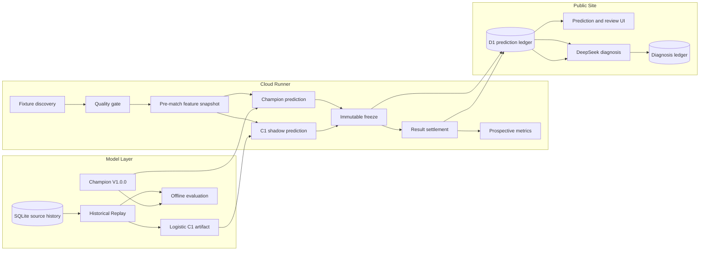

# Architecture

VCT Forecast Lab separates forecasting, unattended execution and public presentation so that a user-facing product can evolve without giving an AI narrative layer control over the mathematical model.

## System view

## 1. Model layer

The model layer owns mathematical and historical reasoning:

- **SQLite** stores normalized Event → Match → Map → Player observations in the private production environment.
- **Team rating** updates after a result and rewards performance against stronger opponents.
- **Recent form** applies time decay, opponent strength and score quality.
- **Map modelling** is separate from global team strength.
- **Historical Replay** rebuilds pre-match features using an exclusive timestamp cutoff.
- **Champion V1.0.0** is the frozen official rules-based probability model.
- **Logistic C1** is the first data-driven challenger.
- **Evaluation** measures accuracy, Brier Score, Log Loss, calibration and ECE.

Portfolio entry points:

- [Replay](../model/src/vct_prediction/replay.py)
- [Challenger](../model/src/vct_prediction/challenger.py)
- [Predictor](../model/src/vct_prediction/predictor.py)
- [Rating updates](../model/src/vct_prediction/ratings.py)
- [Backtest metrics](../model/src/vct_prediction/backtest.py)

The production SQLite database is deliberately excluded from this repository.

## 2. Cloud Runner

The Runner is an unattended service with a persistent database volume. Its responsibilities are:

1. discover candidate fixtures;
2. normalize teams and schedules;
3. apply a hard Ready/Blocked quality gate;
4. construct one timestamped feature snapshot;
5. generate Champion and C1 probabilities from that same snapshot;
6. freeze both records before match start;
7. import the confirmed result;
8. settle both models independently;
9. publish bounded records and coverage counters to the public ledger.

The C1 loader is read-only. It loads a frozen feature schema, train-only imputation values, standardization parameters, coefficients and intercept. It has no training method.

Portfolio entry points:

- [Automation lifecycle](../runner/src/vct_prediction/automation.py)
- [Frozen C1 and prospective metrics](../runner/src/vct_prediction/shadow.py)
- [Append-only database schema](../runner/src/vct_prediction/db.py)
- [Public bridge](../runner/bridge/vct_public_bridge.py)
- [Exact-fixture settlement reconciliation and quarantine](../runner/src/vct_prediction/settlement_checks.py)
- [Read-only frozen C1 cohort diagnostics](../runner/src/vct_prediction/cohort_evaluation.py)

## 3. Public Site

The Public Site is a read-oriented product surface backed by D1:

- prediction history;
- locked probability and score distribution;
- variable contributions and map probabilities;
- result settlement;
- post-match review;
- Champion/C1 comparison;
- DeepSeek post-match diagnosis;
- Challenger state and blocker coverage.

The API validates an automation secret at runtime, but no production secret or Sites project binding is included in this portfolio repository.

Portfolio entry points:

- [D1 schema](../site/db/schema.ts)
- [Prediction store](../site/lib/prediction-store.ts)
- [DeepSeek schemas](../site/lib/deepseek.ts)
- [Result settlement route](../site/app/api/automation/results/route.ts)
- [Prediction detail UI](../site/app/predictions/[id]/page.tsx)

## Integrity boundaries

| Boundary | Enforcement |
|---|---|
| Prediction happens before result | Freeze timestamp and scheduled-match validation |
| Champion and C1 see the same information | Shared feature snapshot ID and hash |
| Frozen records cannot be rewritten | Database trigger plus idempotent upsert checks |
| Historical tests do not inflate prospective metrics | Explicit record kind and eligibility filter |
| Blocked fixtures do not enter the gate | Gold/Ready hard gate |
| DeepSeek cannot control the model | Strict schema, stored false permissions and settlement-before-analysis flow |
| AI failure cannot lose the result | Settlement commits before optional diagnosis |

## Deployment boundary

This repository is a portfolio export. GitHub is not a production deployment source:

- no Railway linkage is included;
- no Sites hosting project ID is included;
- no D1 database is included;
- no production secrets are included;
- changing this repository does not alter the live system.
