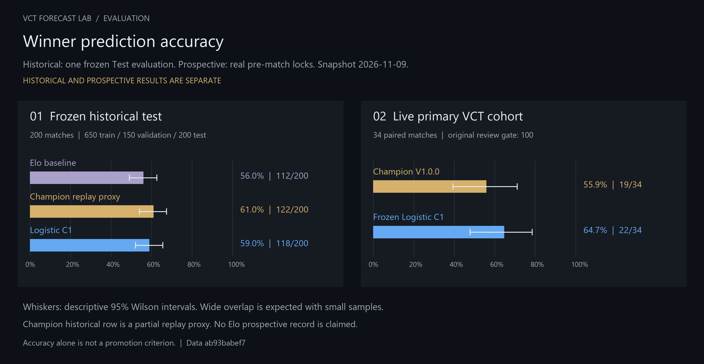
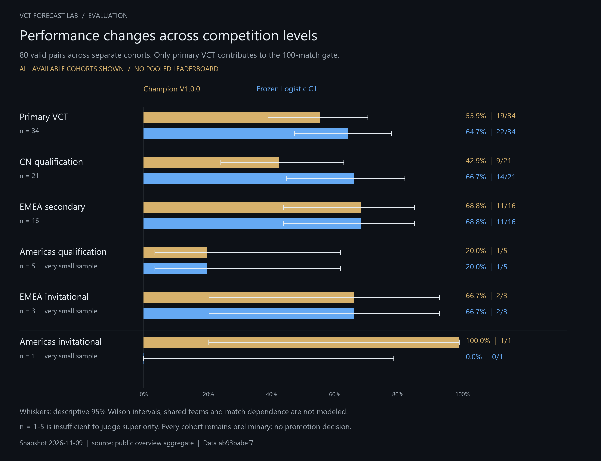
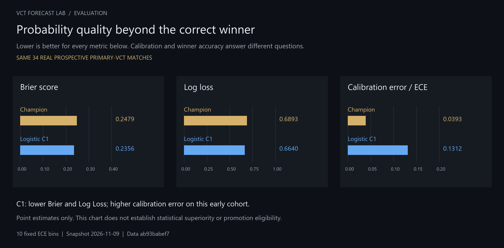

# Evaluation

VCT Forecast Lab evaluates probability quality, not only whether the predicted winner was correct.

## Chronological split

The V1.4B historical dataset was sorted by match time and fixed as:

| Split | Matches | Role |
|---|---:|---|
| Train | 650 | Fit imputation, scaling and Logistic coefficients |
| Validation | 150 | Select bounded regularization |
| Frozen Test | 200 | One final historical comparison |

There is no random shuffle:

```text
earliest ───────────────► latest
Train 650 | Validation 150 | Frozen Test 200
```

The ordered Test IDs were hashed before final evaluation. Once inspected, this Test set may not be used to repeatedly change features, tune parameters or select a successor.

## Compared models

### Elo baseline

A simple chronological rating baseline. Each pre-match probability uses only the current rating at that time; the result updates ratings only for later matches.

### Champion V1.0.0 partial replay proxy

The official model's replay-safe factors are reconstructed without modifying the frozen Champion rules. Several online factors cannot be reproduced fairly from the historical archive, so this row is explicitly a **partial proxy**, not the complete production Champion.

### Logistic Challenger C1

A small, interpretable Logistic Regression model using ten feature differences plus missing/imputed indicators. Preprocessing is fit on Train only.

## Metrics

For a binary target y and Team A probability p:

- **Accuracy** checks whether the side above 50% won.
- **Brier Score** is the mean squared probability error: (p - y)².
- **Log Loss** penalizes confident wrong probabilities more heavily.
- **Calibration** asks whether events assigned about 70% happen about 70% of the time.
- **ECE** summarizes weighted calibration-bin error.

Lower Brier, Log Loss and ECE are better. Accuracy is useful but is not sufficient to judge probability quality.

## Historical result

| Model | Brier | Log Loss | Accuracy |
|---|---:|---:|---:|
| Elo | 0.252311 | 0.703687 | 56.0% |
| Champion Partial Replay Proxy | 0.243952 | 0.683014 | 61.0% |
| Logistic C1 | 0.243037 | 0.679587 | 59.0% |

Logistic C1 ECE: **0.063562**

## Verdict

**INCONCLUSIVE**

C1 clearly outperformed Elo. Against the Champion partial proxy, however:

- Brier improved only slightly;
- Log Loss improved only slightly;
- Accuracy was two percentage points lower;
- the predeclared promotion margin was not met.

Therefore C1 was not promoted.

## Historical versus prospective evaluation

Historical replay asks:

> If the model had existed then, what would it have predicted using only information available then?

Prospective evaluation asks:

> Was this exact probability actually frozen before a future match and later settled against the real result?

They are stored separately. The 200 historical Test matches are never added to the prospective count.

## Prospective snapshot — 2026-11-09

Read at **2026-11-09 14:43 Asia/Shanghai** from the existing public aggregate endpoints. This is a dated snapshot, not a continuously updating repository badge.

- 97 system predictions; 88 published C1 records; **80 valid resolved paired comparisons**.
- Original primary-VCT gate: **34/100**, PRELIMINARY, EVALUATING; promotion disabled.
- Other cohorts: CN qualification21, EMEA secondary16, Americas qualification5, EMEA invitational3, Americas invitational1. They do not contribute to the primary gate.
- Historical Test inclusion: false. C1 retrained: false. Artifact identity remains frozen.
- One BO3/BO5 result conflict is excluded and preserved as a quarantine. Counts of stored observations, discovered fixtures, published results, and eligible pairs are distinct.



| Cohort | Paired matches | Model | Winner accuracy | Brier | Log Loss | ECE (10 bins) |
|---|---:|---|---:|---:|---:|---:|
| Primary VCT | 34 | Champion | 19/34 (55.9%) | 0.247917 | 0.689298 | 0.039284 |
| Primary VCT | 34 | Frozen C1 | 22/34 (64.7%) | 0.235605 | 0.664047 | 0.131233 |
| CN qualification | 21 | Champion | 9/21 (42.9%) | 0.242686 | 0.674935 | 0.259385 |
| CN qualification | 21 | Frozen C1 | 14/21 (66.7%) | 0.235400 | 0.662573 | 0.125283 |
| EMEA secondary | 16 | Champion | 11/16 (68.8%) | 0.219895 | 0.629678 | 0.216298 |
| EMEA secondary | 16 | Frozen C1 | 11/16 (68.8%) | 0.238141 | 0.668920 | 0.192078 |
| Americas qualification | 5 | Champion | 1/5 (20.0%) | 0.284997 | 0.762895 | 0.389425 |
| Americas qualification | 5 | Frozen C1 | 1/5 (20.0%) | 0.335395 | 0.868614 | 0.456429 |
| EMEA invitational | 3 | Champion | 2/3 (66.7%) | 0.209714 | 0.609700 | 0.445539 |
| EMEA invitational | 3 | Frozen C1 | 2/3 (66.7%) | 0.184181 | 0.559076 | 0.425345 |
| Americas invitational | 1 | Champion | 1/1 (100.0%) | 0.241067 | 0.675280 | 0.490986 |
| Americas invitational | 1 | Frozen C1 | 0/1 (0.0%) | 0.413597 | 1.030342 | 0.643115 |



The same matches are used within each Champion/C1 pair. No cross-tier pooled accuracy is used to present a winner. Tiny 1-5 match samples remain visible, including unfavorable outcomes; they cannot establish generalization. N=1 bootstrap intervals in the upstream diagnostic aggregate are degenerate and are not used as evidence of significance.



On the primary cohort, C1 has lower Brier and Log Loss but higher ECE. CN point estimates also favor C1, while EMEA secondary and Americas qualification Brier estimates currently favor Champion. These are preliminary observations, not causal or promotion conclusions.

### Chart protocol and reproduction

- Accuracy charts show the full 0-100% axis, exact correct/total counts and descriptive 95% Wilson intervals.
- Wilson intervals use a simple independent-Bernoulli approximation; repeated teams and dependent matches are not accounted for. Do not infer a paired-model significance test from interval overlap.
- Each probability metric has a zero-based labeled axis; Brier, Log Loss and ECE scales differ.
- Source: [saved aggregate snapshot](data/evaluation-snapshot-2026-11-09.json); historical values: [saved V1.4B evaluation](../model/artifacts/logistic_c1_v1_4b_evaluation.json).
- Reproduction: `python scripts/render_evaluation_charts.py` from the repository root with Pillow and an installed TrueType font. Use `--font /path/to/font.ttf` if automatic font discovery is unavailable. PNG and editable SVG share the same primitive scene.
- The chart generator makes no network calls, reads no database, fits no model, and does not rerun the historical Test.
- No live Elo prediction history or independent formal DeepSeek probability is available for this comparison; neither is fabricated.

### Primary gate

| Eligible primary matches | Progress label |
|---:|---|
| 0-29 | ACCUMULATING |
| 30-49 | PRELIMINARY |
| 50-99 | EVALUATING |
| 100+ | GATE_READY |

These are progress labels, not model-quality verdicts. GATE_READY permits a separately authorized review; it does not automatically promote or reject C1. Gold training eligibility remains a separate42-fixture measure.

## Anti-selection rules

The evaluation protocol forbids:

- changing the Test set after seeing results;
- deleting difficult matches;
- selecting only favorable events;
- retuning features against the frozen Test;
- counting blocked fixtures;
- generating a probability after the result;
- promoting based on accuracy alone;
- allowing an AI narrative to decide promotion.
