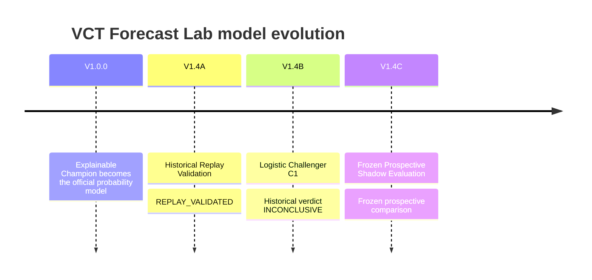

# Model Evolution

This document records completed evidence. It does not invent future promotion outcomes.

## Timeline

## V1.0.0 - Champion

The initial Champion is an interpretable rules-based model combining:

- dynamic team rating;
- opponent-adjusted recent form;
- independent map strength;
- player form;
- roster continuity;
- event-cohort context;
- international experience;
- BO3/BO5 adaptability;
- tactical matchup context.

It remains the only official online probability model.

## V1.4A - Historical Replay Validation

Goal: prove that historical features can be rebuilt without seeing the future.

Result: **REPLAY_VALIDATED**

- 30 consecutive VCT CN matches;
- strict source_time < target_time;
- minimum prior history requirement;
- prior-observed roster rule;
- explicit missingness;
- five poison-future checks;
- five manual spot checks.

No model was trained in this stage.

## V1.4B - First Data-Driven Challenger

Goal: compare Elo, the Champion replay-safe proxy and one simple Logistic Regression challenger.

Dataset:

- 1,000 chronological eligible matches;
- 650 Train;
- 150 Validation;
- 200 frozen Test.

Result: **INCONCLUSIVE**

C1 improved Brier and Log Loss slightly over the partial Champion proxy but did not satisfy the predeclared promotion rule and had lower Accuracy. The system rejected the temptation to promote on a marginal result.

## V1.4C - Prospective Shadow

Goal: run frozen C1 next to Champion on future eligible fixtures.

State verified on 2026-11-09 14:43 Asia/Shanghai: **PRELIMINARY**

- Champion and C1 use the same pre-match snapshot;
- both probabilities are frozen before the match;
- both are settled independently;
- historical and isolated records are excluded;
- DeepSeek may diagnose errors after settlement;
- promotion is disabled before 100 eligible resolved matches.

At this dated portfolio refresh, the original primary-VCT prospective gate remains **34/100**. Separately tracked cohorts total **80 valid pairs** across primary VCT, CN/Americas qualification, EMEA secondary and EMEA/Americas invitationals; these are not80 primary-gate matches. Champion remains the sole official probability model; C1 has not been retrained or promoted.

## Reliability and coverage follow-up

The source snapshot now includes separate pre-match/post-match AI job queues, deterministic map/series finality checks, stable-result confirmation and append-only result/metric corrections. The reader-facing Site presents prediction history, individual prediction details, match reviews and model comparison.

The October coverage repair checks five global/four-region all-tier source indexes and recognizes adjacent-season, qualification, secondary and invitational events. Observation is separate from prediction readiness. Those new competition cohorts are kept separate from the original primary-VCT prospective gate.

The November operational recovery adds exact-fixture settlement reconciliation, series-format quarantine and frozen-artifact per-cohort diagnostics. Coverage remains partial, new-team historical data enrichment is unfinished and AI review reliability still needs work. These are known limitations, not completed model improvements.

## What comes next

Only observed evidence may extend this timeline. Valid future states include:

- continued evaluation;
- rejection;
- a separately versioned challenger experiment;
- promotion after the formal gate and governance review.

The following are deliberately not claimed:

- C1 promoted;
- C1 rejected prospectively;
- C2 created;
- LightGBM adopted;
- automatic self-improvement completed.
